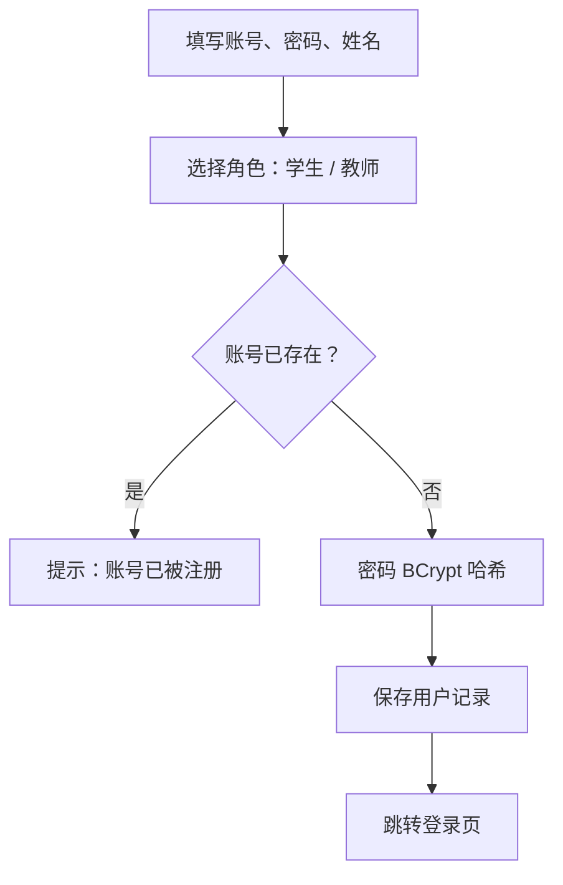
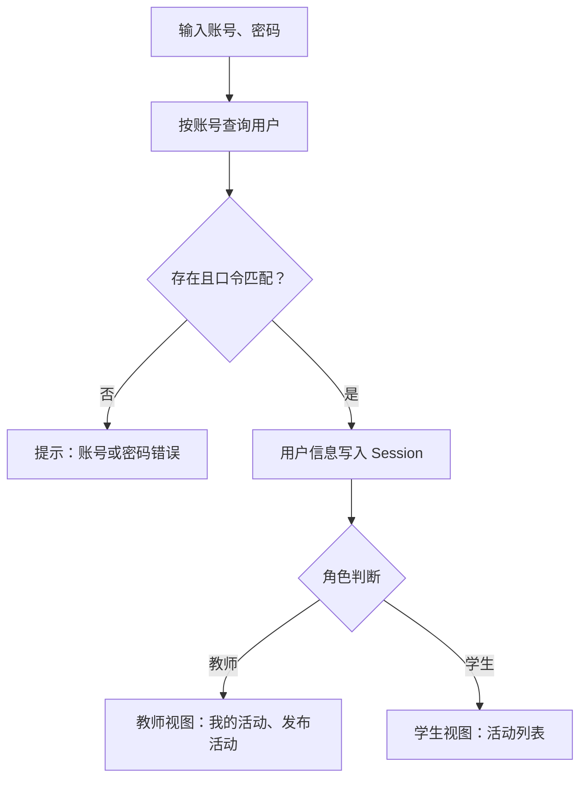
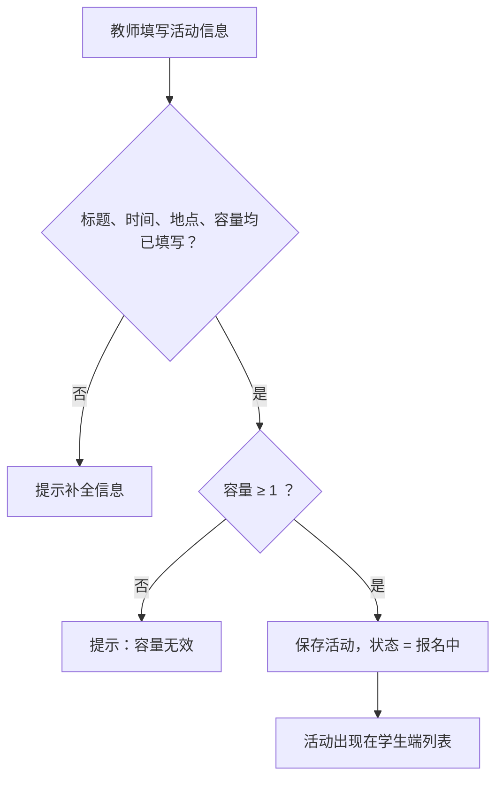
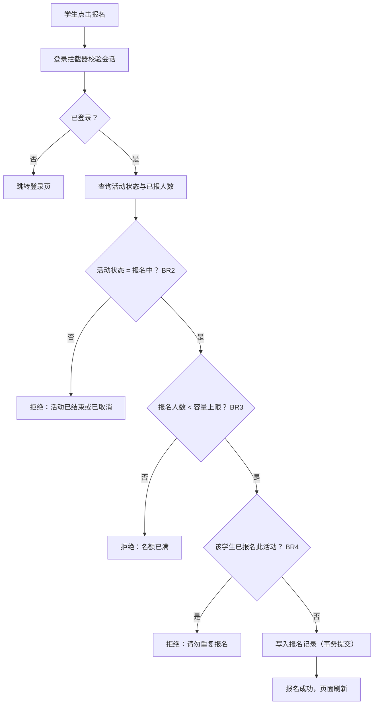
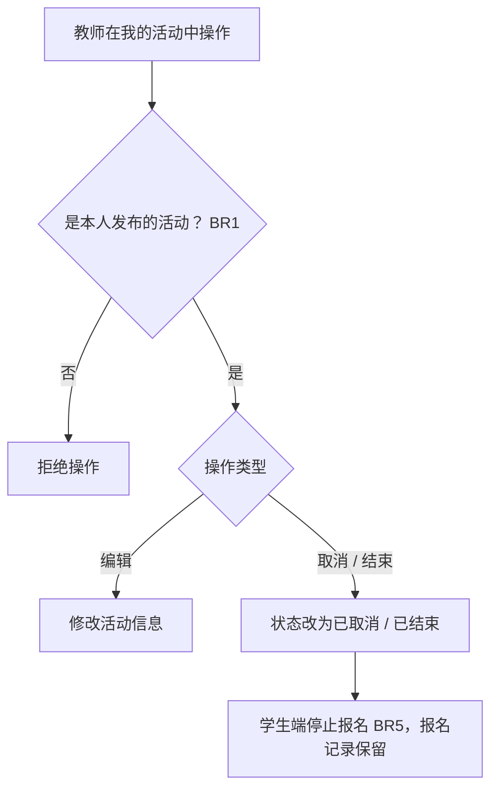
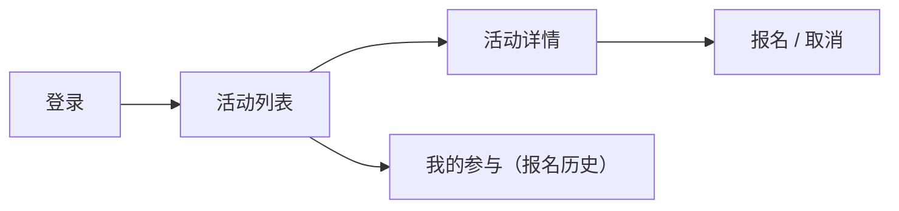

# 校园活动管理系统 V1.0 — 软件设计

> **表达形式说明**：依据《工程意图》，本设计以**流程图**为主要表达形式（mermaid 语法，Gitee 网页端可直接渲染查看），辅以模块职责表和数据表设计。设计回答两个问题：**软件如何组织**（第 2、4 节）与**各部分如何协作**（第 3 节流程图）。

---

## 1. 设计概述

- **技术栈**：Java 17 + Spring Boot 3 + Thymeleaf + Spring Data JPA + H2 + Maven
- **分层结构**：Controller（页面与请求入口，含登录拦截器）→ Service（业务规则 BR1–BR5 全部在此实现）→ Repository（数据访问）→ H2 数据库
- **设计原则**：
  1. 业务规则集中在 Service 层，与验收场景一一对应，便于验证；
  2. 实现以简单直接为先，不引入超出小组理解范围的技术；
  3. 每个流程的判断节点均标注对应业务规则（BR）与需求编号（FR），保证可追踪。

## 2. 模块划分（软件如何组织）

| 模块 | 职责 | 对应需求 | 关键组成 |
|---|---|---|---|
| 用户模块 | 注册、登录、会话管理、角色视图分流 | FR1、FR2 | UserController、UserService、登录拦截器 |
| 活动模块 | 活动发布、列表、详情、编辑、取消/结束 | FR3、FR4、FR7 | ActivityController、ActivityService |
| 报名模块 | 报名/取消报名、校验规则、名单查看 | FR5、FR6 | EnrollmentController、EnrollmentService |
| 公共支撑 | 实体定义、仓库接口、页面布局 | — | 三个实体、三个 Repository、基础模板 |

## 3. 核心流程设计（各部分如何协作）

### 3.1 注册流程（FR1）

### 3.2 登录与角色分流（FR2）

### 3.3 活动发布流程（FR3，教师）

### 3.4 活动报名流程（FR5）★核心流程

> 三项校验全部位于 EnrollmentService；取消报名为逆向操作：校验报名记录存在且活动仍在报名中，删除记录。

### 3.5 活动管理流程（FR7，教师）

### 3.6 学生端页面流转

教师端页面流转：登录 → 我的活动 →（发布 / 编辑 / 取消 / 查看名单）。

## 4. 数据设计

| 表 | 字段 | 说明 |
|---|---|---|
| 用户表 app_user | id、username（唯一）、password（BCrypt 哈希）、name、role（STUDENT/TEACHER） | 注册时创建（物理表名 app_user，"user" 为 H2 保留字，见第 6 节调整记录） |
| 活动表 activity | id、title、description、time、place、capacity、status（OPEN/CLOSED/CANCELLED）、teacher_id | 发布时创建，状态由管理操作流转 |
| 报名记录表 enrollment | id、activity_id、user_id、create_time | 报名时创建；（activity_id, user_id）联合唯一 → 数据库层面兜底防重复 |

**关系**：教师 1—n 活动（teacher_id）；活动 1—n 报名记录（activity_id）；学生 1—n 报名记录（user_id）。

## 5. 设计—需求—验证对应关系（可追踪性）

| 设计流程 | 满足的需求 | 落实的规则 | 对应验收场景 |
|---|---|---|---|
| 注册、登录分流 | FR1、FR2 | 角色区分 | S1 |
| 活动发布 | FR3 | 容量 ≥ 1 | S2 |
| 活动管理 | FR7 | BR1、BR5 | S5 |
| 报名校验 | FR5 | BR2、BR3、BR4 | S3 |
| 名单查看 | FR6 | — | S4 |
| 我的参与 | FR4 | — | S6 |

## 6. 设计调整记录

开发过程中如对设计做出调整，在此登记（任务书要求：设计应与最终软件保持基本一致，明显调整需说明原因）。

| 日期 | 调整内容 | 原因 |
|---|---|---|
| 2026-09-11 | 用户表物理表名 user → app_user | "user" 是 H2 数据库保留字，直接建表会失败；逻辑名称不变，仅调整物理表名 |

---

*依据：docs/需求分析.md · docs/工程意图.md*
